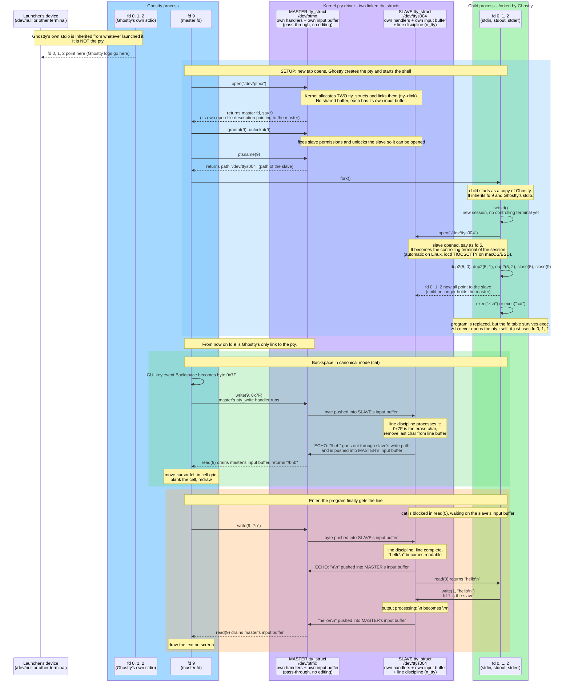

import { ThemeImage } from '../../src/components/ThemeImage';

# Terminals

Terminals are desktop applications, like a browser.
A browser can open many web apps.
In the same way, a terminal can open many apps, such as bash, nushell, zsh, or even a python REPL.

:::tip Which process does the user interact with?
What the user sees and interacts with, is the terminal process.
The terminal process then speaks to the shell process via the PTY.
:::

<ThemeImage src='/img/terminal-shell.excalidraw.png' alt='terminal-shell' />

:::important terminal is what you choose
Terminal software is what you manually choose by starting it.
The default application the terminal starts is the **shell**
and is part of the user configuration.
:::

## Real vs Pseudo Terminals

Pseudo terminal apps just emulate what physical terminals did in the past.

<ThemeImage src='/img/linux-pseudo-vs-real-terminals.excalidraw.png' alt='terminal-comparison' />

## Line Discipline

In a terminal, the **line discipline** is the way input and output are handled.

:::important Discipline enforcement
This discipline is handled by the slave TTY driver.
It ensures the characters are sent to the end program only after enter is received,
or if there is a Ctrl+C received, it will interrupt the program by scheduling an interrupt handler.
See details in the signals [page](./signals.mdx).
:::

1. When you type characters, they show on screen. But they aren't sent to bash or any forked program yet.
2. When the Enter key is pressed, the line discipline sends the entire line to the program.
3. Terminal also handles special keys like Ctrl+C, which sends a signal to the program to interrupt it.

## Shell doesn't display anything

Whatever you type in the terminal isn't the bash feature.
Terminal just displays whatever events it receives from the keyboard.

:::warning terminal applications needs to know which terminal

Terminal apps like vim, less, and top must know which terminal runs them.
The shell builds output and escape characters based on the terminal.

It reads **$TERM**, then gets the details from **/usr/share/terminfo**.
:::

Receives input → displays it on screen → send to master →
TTY driver sends it to slave → slave is connected to bash → bash reads input from slave.

:::danger shell is deceiving
Even though it looks like Bash is doing all by itself,
it's the terminal which sends the input to the bash process and
displays the output from bash.
:::

<ThemeImage src='/img/shell-display.excalidraw.png' alt='terminal-shell-relation' />

## tty command

The 'tty' command shows which slave device is connected to the current shell.
Each shell knows only its slave device. It reads input and writes output there.

## Terminal Configuration

Each user's default shell is set in the **/etc/passwd** file.

:::tip remote connection to a machine
When you connect to a machine with SSH, the terminal is on your local machine.
The SSH server creates a bash process on the remote machine.

The SSH server makes a slave device for bash.
The SSH client makes a master device for the terminal.
The flow is the same. Just the slave is remote and the master is local.
:::

## Terminal Prompt

The prompt is just another **stdout** bash returns to the terminal.
Bash has a config to return a set string whenever it's ready for a new command.

It returns the same prompt after the last command runs.

## oh-my-posh and nerd-fonts

The relation between these projects are exactly what's described above.

1. **oh-my-posh** is a **shell prompt theme engine**. It builds the prompt string.
   It sets the shell to make the prompt with Unicode characters.
2. **nerd-fonts** is a set of fonts with extra glyphs and icons.
   The Unicode values from the shell prompt are rendered with these fonts.

## tmux - Terminal Multiplexer

:::warning Problem with terminals
When the terminal window is killed,
then the bash process as well as the connection to the PTY is gone.
Which means the entire session is lost.

Another big advantage is that,
**tmux makes the entire management of terminals programmable**.
Which means, we can start terminals, split, close and many more which can't be done by regular terminal applications.
:::

tmux solves this problem by hosting the PTY process outside the terminal application.
It uses a client server architecture by making the server durable and holding all the session data.

<ThemeImage src='/img/linux-tmux.excalidraw.png' alt='tmux' />

:::important tmux for SSH
tmux is useful for SSH too by doing an SSH into the server
and then starting the tmux on it and then executing commands.
Next time when we SSH, we can directly attach again to the same tmux session
and continue from where left off.
:::

### Running multiple panes in non-shell applications

When herdr or tmux application started from the terminal,
it just paints the entire terminal window.
Meaning, every location of the window is written by the herdr or tmux client process.

The non-shell application then start shell as child process.
Without this there is no way to interact with the CLI application.

:::danger Feeling of multiple terminals
Even though it looks like multiple terminals for the user,
the application is actually updating the entire window as one single entity.
:::

<ThemeImage src='/img/linux-terminal-start-process.excalidraw.png' alt='tmux' />

## Glyphs and Character Codes

The application only writes the character codes to the terminal.
The terminal then renders the character codes with the font it has.

:::warning ANSI Escape Characters for output format
Terminal application only write data. They use Unicode to write data.

These applications only write ANSI escape character to control how the lines are displayed.
Everything that follows the escape character is a command and not the data itself.
The actual font based rendering is done by the terminal itself.

Example - \x1b[38;2;0;0;181m
:::

:::important what's a glyph?
Glyph is a Greek word for carving.
In computing, it's a visual representation of a character code.
:::

## Handover of data between terminal, kernel and application

Consider the terminal application only reads and writes to the file descriptor of the master device.
The kernel acts the device driver of this device.
It then forwards the data to the slave device which is connected to the application.
The slave device acts as the stdio and stderr channels for the application.

<!-- markdownlint-disable MD013-->

